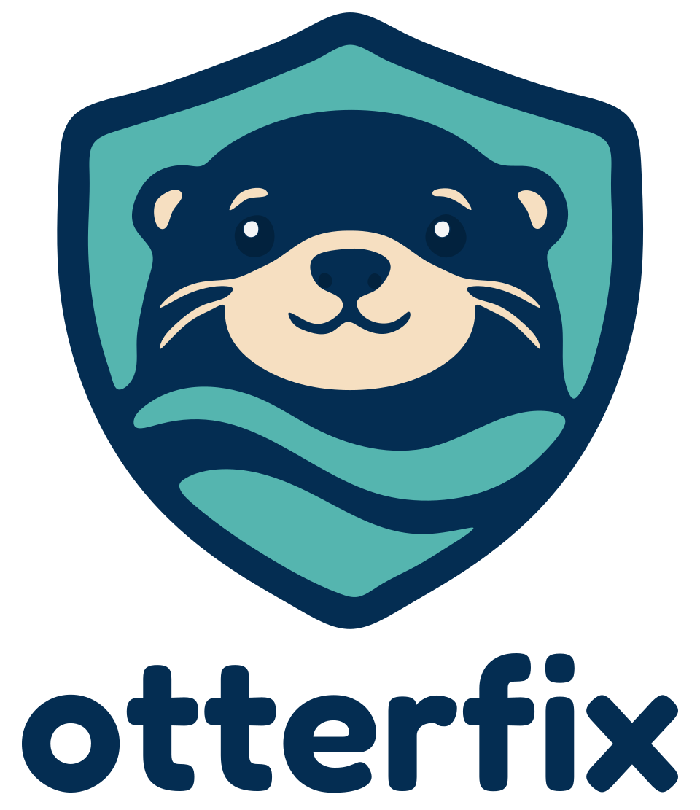

# Otterfix Harness

<p align="center">
  
</p>

The Harness software is licensed under [Apache-2.0](LICENSE). The Otterfix name and logo are reserved branding of Joan Fabregat and are excluded from that license; see [trademark notice](TRADEMARKS.md) and [branding terms](docs/brand/LICENSE.md).

Otterfix Harness is an open source Rust remediation engine: consume normalized security findings, run a bounded API-based agent, and independently validate dependency, code, or configured workload changes.

The core is independent of Git hosting and execution location. GitHub is the first integration target. Callers own acquisition, lifecycle orchestration, publication, and delivery; repository CI/CD retains authoritative checks and deployment approval. Standalone execution requires no commercial service.

The first implementation provides a Trivy Cargo triage CLI, versioned public contracts, Cargo metadata parsing, preliminary candidate-scope checks, and a bounded provider/tool loop. OpenAI and Gemini live transports, repository execution, patch application, independent security validation, and publication are subsequent work. The configured workload-image update path is planned. Read the [architecture decisions](docs/adr/README.md) for the contracts and boundaries.

## Run the synthetic example

```sh
cargo run --locked -- triage --report tests/fixtures/trivy-cargo.json --policy tests/fixtures/policy.json
```

The JSON output preserves scanner evidence and marks three synthetic findings as eligible, no-fix, or excluded by policy. Eligibility means further analysis is needed; it does not establish a validated fix. Inputs are limited to 16 MiB each. Treat reports and repository files as untrusted and execute dependency-bearing builds in an appropriate sandbox.

CI audits dependencies, checks formatting, runs clippy, and tests the contracts and failure boundaries. Candidate checks consume trusted caller-derived diff summaries and do not authenticate patches or enforce source-contained test protections by themselves. Live executor implementations must honor cancellation and deadlines during calls. No crate or release is published. The CLI, library, and public contracts are licensed under [Apache-2.0](LICENSE).
